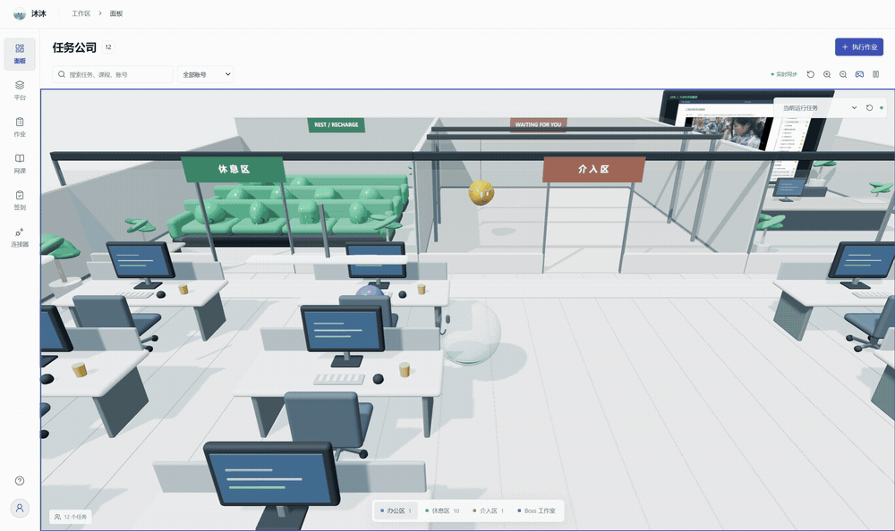

<h1>Mumu</h1>

**Unblock learning bottlenecks in one click**

[简体中文](README.md) · **English** · [繁體中文](README.zh-TW.md) · [한국어](README.ko.md) · [日本語](README.ja.md) · [Español](README.es.md)

[Download](https://github.com/ravicc02/Mumu/releases) · [Changelog](CHANGELOG.md) · [Issues](https://github.com/ravicc02/Mumu/issues/new/choose) · [Contributing](CONTRIBUTING.md)

## Usage Notice

> [!CAUTION]
> Mumu is a local Windows learning-task client. Use it only with your own accounts or accounts you are explicitly authorized to manage.
>
> Do not use this project for commercial task farming, account resale, bypassing platform verification, data theft, or other unlawful activity. You are responsible for account restrictions, data loss, and legal consequences caused by use that violates school or platform rules.

> [!IMPORTANT]
> Mumu is not affiliated with or endorsed by Xuexitong, EduCoder, Zhihuishu, ICourse163, ICVE, ZJY, or Yuketang. Names and logos identify the connected services only.
>
> Platform pages and capabilities may change. Mumu does not guarantee support for every school, course, question type, or page version. Model requests send task context to the provider you configure. Confirm platform rules and data-handling requirements before use.

### Disclaimer

> This project is intended only for technical research and learning exchange. Do not use it in any scenario that violates platform rules, school regulations, or applicable laws and regulations. Users are responsible for the consequences of their use.

## Features

| Feature | Description |
| --- | --- |
| **Accounts and platforms** | Save accounts by platform and stable user ID, sync names and avatars, update existing records after reauthorization, and never merge accounts by display name |
| **Assignments** | Collect unfinished and currently submittable work, identify question types, generate answers, fill deterministically, save drafts, evaluate, and verify submission |
| **Online courses** | Read courses and task points, skip completed content, run supported media and reading flows, and retain platform progress evidence |
| **Attendance** | Process multiple accounts in batches; support codes, gestures, QR codes, and location input, with revocable batch sharing links |

## Supported Platforms

<table width="100%">
<thead>
<tr>
<th width="500" align="center">Platform</th>
<th width="170" align="center">Assignments</th>
<th width="170" align="center">Courses</th>
<th width="170" align="center">Attendance</th>
</tr>
</thead>
<tbody>
<tr>
<td align="center"> <strong>Xuexitong</strong></td>
<td align="center">Yes</td>
<td align="center">Yes</td>
<td align="center">Yes</td>
</tr>
<tr>
<td align="center"> <strong>EduCoder</strong></td>
<td align="center">Yes</td>
<td align="center">—</td>
<td align="center">—</td>
</tr>
<tr>
<td align="center"> <strong>Zhihuishu</strong></td>
<td align="center">—</td>
<td align="center">Yes</td>
<td align="center">—</td>
</tr>
<tr>
<td align="center"> <strong>ICourse163</strong></td>
<td align="center">—</td>
<td align="center">Yes</td>
<td align="center">—</td>
</tr>
<tr>
<td align="center"> <strong>ICVE</strong></td>
<td align="center">—</td>
<td align="center">Yes</td>
<td align="center">—</td>
</tr>
<tr>
<td align="center"> <strong>ZJY</strong></td>
<td align="center">—</td>
<td align="center">Yes</td>
<td align="center">—</td>
</tr>
<tr>
<td align="center"> <strong>Yuketang</strong></td>
<td align="center">—</td>
<td align="center">Yes</td>
<td align="center">—</td>
</tr>
</tbody>
</table>

## Getting Started

1. Download the Windows x64 installer from [Releases](https://github.com/ravicc02/Mumu/releases).
2. On first launch, review the environment check. Install missing dependencies when available, or use the displayed manual command if installation fails.
3. Configure the model endpoint, API key, model, and reasoning effort, then authorize a platform account.

## Data and Privacy

The default data directory is `.mumu` under the user profile, for example `%USERPROFILE%/.mumu`, and stores authorization, tasks, SQLite data, and screenshots.

~~~text
logs/
  main.log       Detailed log for today
  oldmain.log    Archived historical logs
~~~

If a problem occurs, open the log directory from Settings and provide a redacted main.log. Public issues must not include cookies, API keys, QR credentials, or authorization files. See [Security](.github/SECURITY.md).

## Star History

