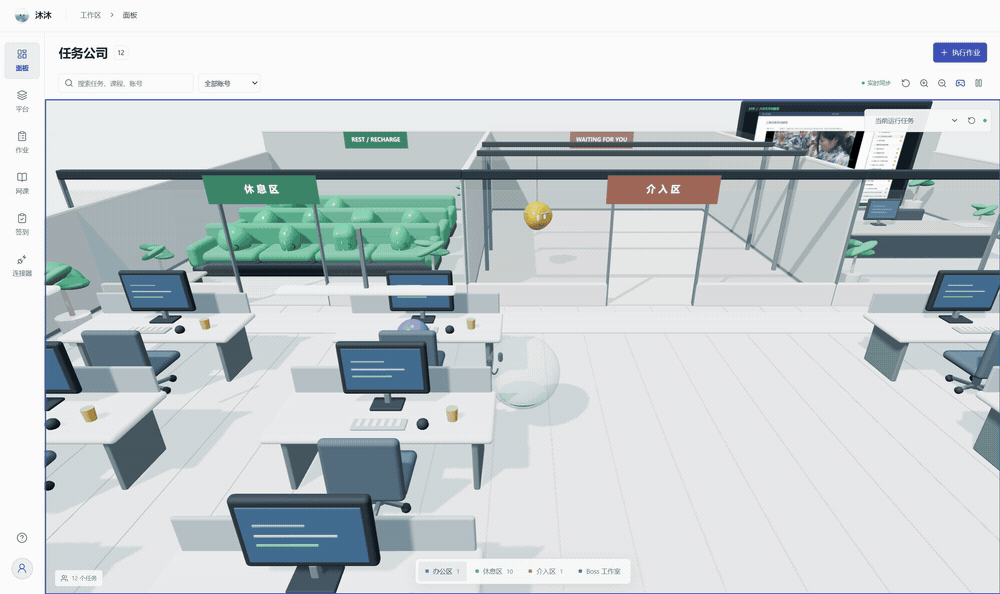

<h1>Mumu</h1>

**Desbloquea tus dificultades de aprendizaje con un clic**

[简体中文](README.md) · [English](README.en.md) · [繁體中文](README.zh-TW.md) · [한국어](README.ko.md) · [日本語](README.ja.md) · **Español**

[Descargar](https://github.com/ravicc02/Mumu/releases) · [Cambios](CHANGELOG.md) · [Incidencias](https://github.com/ravicc02/Mumu/issues/new/choose) · [Guía de contribución](CONTRIBUTING.md)

## Aviso de uso

> [!CAUTION]
> Mumu es un cliente local de tareas de aprendizaje para Windows. Úsalo solo con cuentas propias o con cuentas para las que tengas autorización explícita de gestión.
>
> No utilices este proyecto para realización comercial de tareas, venta de cuentas, elusión de la verificación de plataformas, robo de datos u otras actividades ilegales. El usuario es responsable de las restricciones de cuenta, la pérdida de datos y las consecuencias legales derivadas de un uso que infrinja las normas de la escuela o de la plataforma.

> [!IMPORTANT]
> Mumu no está afiliado ni respaldado por Xuexitong, EduCoder, Zhihuishu, ICourse163, ICVE, ZJY o Yuketang. Los nombres y logotipos solo identifican los servicios conectados.
>
> Las páginas y capacidades de las plataformas pueden cambiar. Mumu no garantiza compatibilidad con todas las escuelas, cursos, tipos de pregunta o versiones de página. Las solicitudes al modelo envían el contexto de la tarea al proveedor configurado. Confirma las normas de la plataforma y los requisitos de tratamiento de datos antes de usar la aplicación.

### Descargo de responsabilidad

> Este proyecto está destinado únicamente a la investigación técnica y el intercambio de aprendizaje. No lo utilices en ninguna situación que infrinja las normas de las plataformas, las regulaciones escolares o las leyes y reglamentos aplicables. Cada usuario asume la responsabilidad correspondiente.

## Funciones

| Función | Descripción |
| --- | --- |
| **Cuentas y plataformas** | Guarda cuentas por plataforma e ID de usuario estable, sincroniza nombres y avatares, actualiza el registro existente tras una nueva autorización y nunca fusiona cuentas por nombre visible |
| **Tareas** | Recopila tareas sin terminar y actualmente entregables; identifica tipos de pregunta, genera respuestas, completa de forma determinista, guarda borradores, evalúa y verifica la entrega |
| **Cursos** | Lee cursos y puntos de tarea, omite contenido completado, ejecuta flujos compatibles de medios y lectura, y conserva la evidencia de progreso de la plataforma |
| **Asistencia** | Procesa varias cuentas por lotes; admite códigos, gestos, códigos QR y ubicación, con enlaces de lote revocables |

## Plataformas compatibles

<table width="100%">
<thead>
<tr>
<th width="500" align="center">Plataforma</th>
<th width="170" align="center">Tareas</th>
<th width="170" align="center">Cursos</th>
<th width="170" align="center">Asistencia</th>
</tr>
</thead>
<tbody>
<tr>
<td align="center"> <strong>Xuexitong</strong></td>
<td align="center">Sí</td>
<td align="center">Sí</td>
<td align="center">Sí</td>
</tr>
<tr>
<td align="center"> <strong>EduCoder</strong></td>
<td align="center">Sí</td>
<td align="center">—</td>
<td align="center">—</td>
</tr>
<tr>
<td align="center"> <strong>Zhihuishu</strong></td>
<td align="center">—</td>
<td align="center">Sí</td>
<td align="center">—</td>
</tr>
<tr>
<td align="center"> <strong>ICourse163</strong></td>
<td align="center">—</td>
<td align="center">Sí</td>
<td align="center">—</td>
</tr>
<tr>
<td align="center"> <strong>ICVE</strong></td>
<td align="center">—</td>
<td align="center">Sí</td>
<td align="center">—</td>
</tr>
<tr>
<td align="center"> <strong>ZJY</strong></td>
<td align="center">—</td>
<td align="center">Sí</td>
<td align="center">—</td>
</tr>
<tr>
<td align="center"> <strong>Yuketang</strong></td>
<td align="center">—</td>
<td align="center">Sí</td>
<td align="center">—</td>
</tr>
</tbody>
</table>

## Primeros pasos

1. Descarga el instalador de Windows x64 desde [Releases](https://github.com/ravicc02/Mumu/releases).
2. En el primer inicio, revisa la comprobación del entorno. Instala las dependencias que falten cuando sea posible o utiliza el comando manual mostrado si falla la instalación.
3. Configura el endpoint del modelo, la API Key, el modelo y el esfuerzo de razonamiento; después autoriza una cuenta de plataforma.

## Datos y privacidad

El directorio de datos predeterminado es `.mumu` dentro del perfil del usuario, por ejemplo `%USERPROFILE%/.mumu`, y guarda autorizaciones, tareas, datos SQLite y capturas

~~~text
logs/
  main.log       Registro detallado de hoy
  oldmain.log    Archivo de registros anteriores
~~~

Si aparece un problema, abre el directorio de registros desde Configuración y facilita un main.log con los datos sensibles eliminados. Las incidencias públicas no deben incluir cookies, API Keys, credenciales QR ni archivos de autorización. Consulta [Seguridad y privacidad](.github/SECURITY.md).

## Star History

