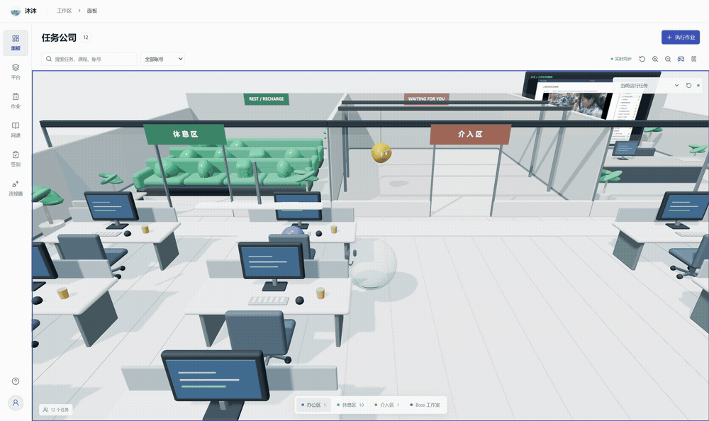

<h1>Mumu</h1>

**学習のつまずきを、ワンクリックで解消**

[简体中文](README.md) · [English](README.en.md) · [繁體中文](README.zh-TW.md) · [한국어](README.ko.md) · **日本語** · [Español](README.es.md)

[ダウンロード](https://github.com/ravicc02/Mumu/releases) · [更新履歴](CHANGELOG.md) · [問題を報告](https://github.com/ravicc02/Mumu/issues/new/choose) · [コントリビューションガイド](CONTRIBUTING.md)

## 使用上の注意

> [!CAUTION]
> Mumu は Windows PC 向けのローカル学習タスククライアントです。本人のアカウント、または管理を明示的に許可されたアカウントでのみ使用してください。
>
> 商業的な代理実行、アカウント販売、プラットフォーム検証の回避、データ窃取、その他の違法行為に本プロジェクトを使用しないでください。学校やプラットフォームの規則に違反する使用によって生じたアカウント制限、データ損失、法的責任は利用者が負います。

> [!IMPORTANT]
> Mumu は Xuexitong、EduCoder、Zhihuishu、ICourse163、ICVE、ZJY、Yuketang と提携しておらず、公式な承認も受けていません。名称とロゴは対象サービスを識別するためだけに使用しています。
>
> プラットフォームのページと対応機能は変更される場合があります。すべての学校、コース、問題形式、ページバージョンでの継続利用を保証するものではありません。モデルリクエストは、利用者が設定したプロバイダーへタスクのコンテキストを送信します。使用前にプラットフォームの規則とデータ処理要件を確認してください。

### 免責事項

> 本プロジェクトは技術研究と学習交流のみを目的としています。プラットフォームの規則、学校の管理規定、法令に違反するいかなる場面でも使用しないでください。利用者はそれに伴う責任を自ら負うものとします。

## 機能紹介

| 機能 | 説明 |
| --- | --- |
| **アカウントとプラットフォーム** | プラットフォームと安定したユーザー ID でアカウントを保存し、名前とプロフィール画像を同期します。再認証時は既存レコードを更新し、表示名だけでアカウントを統合しません |
| **課題** | 未完了かつ現在提出可能な課題を収集し、問題形式の識別、回答生成、決定論的入力、下書き保存、評価、提出検証を行います |
| **オンライン授業** | コースとタスクポイントを読み取り、完了済み内容をスキップし、対応済みのメディア・閲覧フローを実行してプラットフォームの進捗証拠を保存します |
| **出席確認** | 複数アカウントを一括処理し、出席コード、ジェスチャー、QR コード、位置情報入力に対応します。取消可能な一括共有リンクを作成できます |

## 対応プラットフォーム

<table width="100%">
<thead>
<tr>
<th align="center">プラットフォーム</th>
<th align="center">課題</th>
<th align="center">オンライン授業</th>
<th align="center">出席確認</th>
</tr>
</thead>
<tbody>
<tr>
<td align="center"> <strong>Xuexitong</strong></td>
<td align="center">対応</td>
<td align="center">対応</td>
<td align="center">対応</td>
</tr>
<tr>
<td align="center"> <strong>EduCoder</strong></td>
<td align="center">対応</td>
<td align="center">—</td>
<td align="center">—</td>
</tr>
<tr>
<td align="center"> <strong>Zhihuishu</strong></td>
<td align="center">—</td>
<td align="center">対応</td>
<td align="center">—</td>
</tr>
<tr>
<td align="center"> <strong>ICourse163</strong></td>
<td align="center">—</td>
<td align="center">対応</td>
<td align="center">—</td>
</tr>
<tr>
<td align="center"> <strong>ICVE</strong></td>
<td align="center">—</td>
<td align="center">対応</td>
<td align="center">—</td>
</tr>
<tr>
<td align="center"> <strong>ZJY</strong></td>
<td align="center">—</td>
<td align="center">対応</td>
<td align="center">—</td>
</tr>
<tr>
<td align="center"> <strong>Yuketang</strong></td>
<td align="center">—</td>
<td align="center">対応</td>
<td align="center">—</td>
</tr>
</tbody>
</table>

## はじめに

1. [Releases](https://github.com/ravicc02/Mumu/releases) から Windows x64 インストーラーをダウンロードします。
2. 初回起動時に環境チェックを確認します。不足している依存関係はインストールし、失敗した場合は表示される手動コマンドを使用します。
3. モデルのエンドポイント、API Key、モデル、推論強度を設定し、プラットフォームアカウントを認証します。

## データとプライバシー

既定のデータディレクトリはユーザーホーム配下の `.mumu`（例: `%USERPROFILE%/.mumu`）で、認証、タスク、SQLite データ、スクリーンショットを保存します

~~~text
logs/
  main.log       当日の詳細ログ
  oldmain.log    過去ログのアーカイブ
~~~

問題が発生した場合は、設定からログディレクトリを開き、機密情報を除去した main.log を提供してください。公開 Issue には Cookie、API Key、QR 認証情報、認証ファイルを含めないでください。詳細は[セキュリティとプライバシー](.github/SECURITY.md)を参照してください。

## Star History

