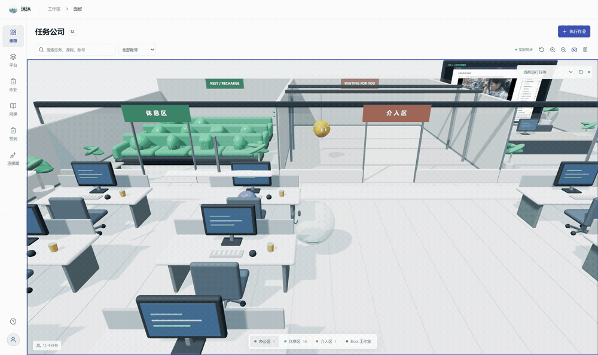

<h1>Mumu</h1>

**학습 막힘, 클릭 한 번으로 해결**

[简体中文](README.md) · [English](README.en.md) · [繁體中文](README.zh-TW.md) · **한국어** · [日本語](README.ja.md) · [Español](README.es.md)

[다운로드](https://github.com/ravicc02/Mumu/releases) · [변경 기록](CHANGELOG.md) · [문제 신고](https://github.com/ravicc02/Mumu/issues/new/choose) · [기여 안내](CONTRIBUTING.md)

## 사용 안내

> [!CAUTION]
> Mumu는 Windows PC용 로컬 학습 작업 클라이언트입니다. 본인 계정 또는 명시적으로 관리 권한을 받은 계정에서만 사용하세요.
>
> 상업적 대리 수행, 계정 판매, 플랫폼 검증 우회, 데이터 탈취 또는 기타 불법 활동에 이 프로젝트를 사용해서는 안 됩니다. 학교나 플랫폼 규칙을 위반하는 사용으로 발생하는 계정 제한, 데이터 손실 및 법적 책임은 사용자에게 있습니다.

> [!IMPORTANT]
> Mumu는 Xuexitong, EduCoder, Zhihuishu, ICourse163, ICVE, ZJY 또는 Yuketang과 제휴하거나 공식 승인을 받은 프로젝트가 아닙니다. 관련 이름과 로고는 해당 서비스를 식별하기 위한 용도로만 사용합니다.
>
> 플랫폼 페이지와 지원 기능은 변경될 수 있습니다. 모든 학교, 강좌, 문제 유형 및 페이지 버전의 지속적인 지원을 보장하지 않습니다. 모델 요청은 사용자가 설정한 공급자에게 작업 컨텍스트를 전송합니다. 사용 전에 플랫폼 규칙과 데이터 처리 요구 사항을 확인하세요.

### 면책 조항

> 이 프로젝트는 기술 연구와 학습 교류 목적으로만 사용해야 하며, 플랫폼 규칙, 학교 관리 규정 또는 법률과 규정을 위반하는 어떤 상황에서도 사용하지 마십시오. 사용자는 그에 따른 책임을 직접 부담해야 합니다.

## 기능 소개

| 기능 | 설명 |
| --- | --- |
| **계정 및 플랫폼** | 플랫폼과 안정적인 사용자 ID를 기준으로 계정을 저장하고 이름과 프로필 이미지를 동기화합니다. 재인증 시 기존 기록을 갱신하며 표시 이름으로 계정을 병합하지 않습니다 |
| **과제** | 미완료 상태이며 현재 제출 가능한 과제를 수집하고, 문제 유형 식별, 답안 생성, 결정적 입력, 임시 저장, 평가 및 제출 검증을 수행합니다 |
| **온라인 강의** | 강좌와 작업 지점을 읽고 완료된 콘텐츠를 건너뛰며, 지원되는 미디어와 읽기 흐름을 실행하고 플랫폼 진행 증거를 저장합니다 |
| **출석** | 여러 계정을 일괄 처리하며 출석 코드, 제스처, QR 코드 및 위치 입력을 지원합니다. 취소 가능한 일괄 공유 링크를 만들 수 있습니다 |

## 지원 플랫폼

<table width="100%">
<thead>
<tr>
<th align="center">플랫폼</th>
<th align="center">과제</th>
<th align="center">온라인 강의</th>
<th align="center">출석</th>
</tr>
</thead>
<tbody>
<tr>
<td align="center"> <strong>Xuexitong</strong></td>
<td align="center">지원</td>
<td align="center">지원</td>
<td align="center">지원</td>
</tr>
<tr>
<td align="center"> <strong>EduCoder</strong></td>
<td align="center">지원</td>
<td align="center">—</td>
<td align="center">—</td>
</tr>
<tr>
<td align="center"> <strong>Zhihuishu</strong></td>
<td align="center">—</td>
<td align="center">지원</td>
<td align="center">—</td>
</tr>
<tr>
<td align="center"> <strong>ICourse163</strong></td>
<td align="center">—</td>
<td align="center">지원</td>
<td align="center">—</td>
</tr>
<tr>
<td align="center"> <strong>ICVE</strong></td>
<td align="center">—</td>
<td align="center">지원</td>
<td align="center">—</td>
</tr>
<tr>
<td align="center"> <strong>ZJY</strong></td>
<td align="center">—</td>
<td align="center">지원</td>
<td align="center">—</td>
</tr>
<tr>
<td align="center"> <strong>Yuketang</strong></td>
<td align="center">—</td>
<td align="center">지원</td>
<td align="center">—</td>
</tr>
</tbody>
</table>

## 시작하기

1. [Releases](https://github.com/ravicc02/Mumu/releases)에서 Windows x64 설치 파일을 다운로드합니다.
2. 최초 실행 시 환경 검사를 확인합니다. 누락된 종속성을 설치할 수 있으면 설치하고, 실패하면 표시되는 수동 명령을 사용합니다.
3. 모델 엔드포인트, API Key, 모델 및 추론 강도를 설정한 뒤 플랫폼 계정을 인증합니다.

## 데이터 및 개인정보

기본 데이터 디렉터리는 사용자 홈 아래의 `.mumu`이며(예: `%USERPROFILE%/.mumu`) 인증, 작업, SQLite 데이터 및 스크린샷을 저장합니다.

~~~text
logs/
  main.log       오늘의 상세 로그
  oldmain.log    보관된 이전 로그
~~~

문제가 발생하면 설정에서 로그 디렉터리를 열고 민감 정보가 제거된 main.log를 제공하세요. 공개 Issue에는 Cookie, API Key, QR 자격 증명 또는 인증 파일을 포함하면 안 됩니다. 자세한 내용은 [보안 및 개인정보](.github/SECURITY.md)를 참고하세요.

## Star History

