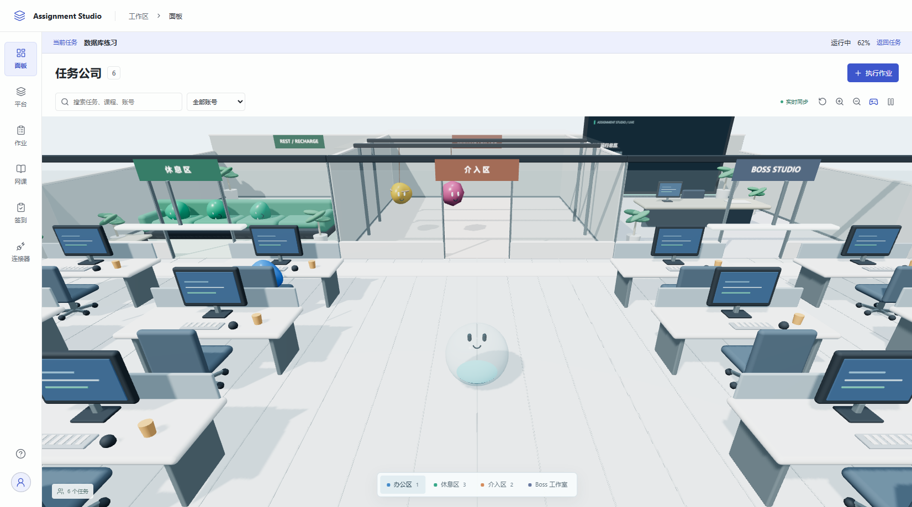

**作业 · 网课 · 签到 · 实时浏览器 · 3D 任务公司**

[下载安装](https://github.com/ravicc02/ai-quiz-assistant/releases) · [使用文档](docs/README.md) · [更新记录](CHANGELOG.md) · [反馈问题](https://github.com/ravicc02/ai-quiz-assistant/issues/new/choose)

Assignment Studio 将多账号学习任务集中在本机管理：授权、采集、执行、人工介入和结果核验使用同一套任务记录。面向 Windows PC，账号授权和运行数据保留在本地，模型服务由使用者配置。

产品界面示意，使用演示账号与任务数据。

## 工作区

| 入口 | 用途 |
| --- | --- |
| **平台** | 授权账号，自动同步名称、头像和稳定身份，按平台能力显示入口 |
| **作业** | 采集未完成且当前可提交的作业；识别题目、填写、暂存、评测及结果核验 |
| **网课** | 读取课程及任务点，跳过已完成内容，执行已支持的媒体和阅读流程 |
| **签到** | 多账号批量处理，提供签到码、手势、二维码和位置输入，创建可撤销的批次分享链接 |
| **任务公司** | 每个任务对应一个 Bot，按状态进入办公区、休息区和介入室；沐沐支持移动、跳跃和 F 交互 |
| **设置** | 模型、思考强度、执行策略、自动检测、微信推送和维护日志 |

执行过程支持实时查看、暂停和人工介入。任务分别使用独立浏览器，关闭查看端不会停止后台执行。软件区分“已填写”“待审核”“结果未知”和“平台确认完成”。

## 平台能力

| 平台 | 作业 | 网课 | 签到 |
| --- | --- | --- | --- |
| 学习通 | 结构化题型、暂存与提交核验 | 媒体、阅读和章节导航适配 | 批量处理与分享 |
| 头歌 | 课堂实验、Java/JUnit 编辑器、自动评测及有限修复 | — | — |
| 知到智慧树 | — | 本地适配器 | — |
| 中国大学 MOOC | — | 本地适配器 | — |
| 智慧职教 / 职教云 | — | 本地适配器 | — |
| 雨课堂 | — | 本地适配器 | — |

头歌 Java/JUnit 已完成一项真实四关实验的整体核验。虚拟机、云桌面及图形实操尚未接入。平台注册不等于所有学校和页面版本均已验收，具体范围见[平台能力](docs/platform-capabilities.md)和[验收记录](docs/educoder-code-execution-validation.md)。

网课适配在项目内运行，不需要安装 OCS Desktop 或脚本管理器。复用范围和来源见[第三方说明](THIRD_PARTY_NOTICES.md)。

## 开始使用

1. 在 [Releases](https://github.com/ravicc02/ai-quiz-assistant/releases) 下载 Windows x64 安装包；发行候选版本标记为 Pre-release。
2. 点击左下角头像，在模型配置中填写接口地址、Key、模型和思考强度。
3. 进入“平台”授权账号，再在对应业务中选择账号和采集范围。
4. 选择任务执行；遇到待处理事项时通过原任务浏览器介入，处理后继续。
5. 查看平台核验结果。学习通最终提交与头歌自动评测分别在作业设置中管理。

安装前可核对附件中的 SHA256SUMS.txt。当前安装包尚未配置 Windows 代码签名；应用支持检查正式版本并打开发布页，不自动安装更新。

### 从源码运行

环境：Windows 10/11 x64、Node.js 24、Python 3.13、Chrome 或 Edge。

~~~powershell
python -m venv .venv
.\.venv\Scripts\python.exe -m pip install -r backend\requirements.txt
npm --prefix desktop ci
$env:ANSWER_STUDIO_PYTHON = (Resolve-Path .\.venv\Scripts\python.exe).Path
npm start
~~~

网页预览分两个终端运行：

~~~powershell
# 终端一：仓库根目录
.\.venv\Scripts\python.exe backend\run_server.py --host 127.0.0.1 --port 8877

# 终端二：仓库根目录
npm run desktop:web
~~~

前端为 http://127.0.0.1:5174/，本地 API 为 http://127.0.0.1:8877/。开发和构建步骤见[贡献指南](CONTRIBUTING.md)。

## 数据与维护

默认数据目录为 %LOCALAPPDATA%/AIAssistantStudio，保存授权、任务、SQLite 和截图。模型请求会将题目及必要上下文发送到使用者配置的模型服务。

~~~text
logs/
  main.log       今日详细日志
  oldmain.log    历史日志归档
~~~

遇到问题，从“设置 → 系统设置”打开日志目录，将脱敏后的 main.log 提供给维护者。公开 Issue 不提交 Cookie、Key、二维码凭据或授权文件，详见[安全与隐私](.github/SECURITY.md)。

## 项目结构

~~~text
desktop/       Vue 界面、Electron 桌面进程、当前产品测试
backend/       FastAPI、平台适配、任务执行及当前产品测试
scripts/       版本、源文件审查、打包、冒烟及发布工具
docs/          使用说明、架构、来源及验收记录
third_party/   固定来源的复用代码及原始许可
.github/       CI、Release、问题模板和依赖维护
~~~

旧 Chrome 扩展、Node 原型和独立演示已移除，历史实现保留在 Git 历史中。测试和本地运行数据不进入安装包。

## 维护与发行

[工作区规范](AGENTS.md) · [文档导航](docs/README.md) · [发布流程](docs/releasing.md) · [更新日志](CHANGELOG.md)

VERSION 是版本唯一来源。main 和 Pull Request 运行 CI；版本标签触发 Windows 打包、冒烟、附件校验及 Release 草稿。正式发布前重新下载校验，已发布版本禁止覆盖。

主项目尚未声明整体许可证，第三方代码保留各自的来源和许可。本项目不代表或隶属于所列教育平台，请在有权操作的账号和课程范围内使用。
