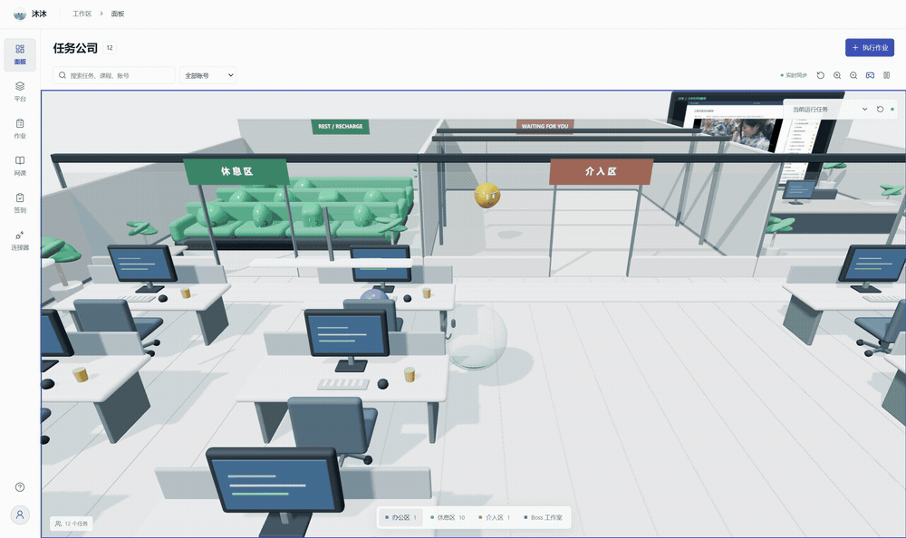

<h1>Mumu</h1>

**學有卡點，一鍵打通**

[简体中文](README.md) · [English](README.en.md) · **繁體中文** · [한국어](README.ko.md) · [日本語](README.ja.md) · [Español](README.es.md)

[下載安裝](https://github.com/ravicc02/Mumu/releases) · [更新記錄](CHANGELOG.md) · [回報問題](https://github.com/ravicc02/Mumu/issues/new/choose) · [貢獻指南](CONTRIBUTING.md)

## 使用須知

> [!CAUTION]
> Mumu 是面向 Windows PC 的本機學習任務用戶端。請在本人帳號或已取得明確授權的範圍內使用。
>
> 嚴禁商業代刷、帳號租售、繞過平台驗證、竊取資料或將本專案用於其他違法違規用途。因使用方式違反學校、平台規則或法律法規所產生的帳號限制、資料損失及法律責任，由使用者承擔。

> [!IMPORTANT]
> Mumu 不代表或隸屬於學習通、頭歌、知到智慧樹、中國大學 MOOC、智慧職教、職教雲和雨課堂。相關名稱與 Logo 僅用於識別對應服務。
>
> 平台頁面與能力可能變更，專案不保證所有學校、課程、題型與頁面版本持續可用。模型請求會將完成任務所需的上下文傳送至你設定的模型服務，使用前請確認平台規則、課程要求與資料處理邊界。

### 免責聲明

> 本專案僅用於技術研究與學習交流，請勿用於任何違反平台規則、學校管理規定或法律法規的場景。使用者需自行承擔相應責任。

## 功能介紹

| 功能 | 說明 |
| --- | --- |
| **帳號與平台** | 依平台與穩定使用者 ID 儲存帳號，自動同步名稱與頭像；重新授權時更新原記錄，不依顯示名稱合併帳號 |
| **作業** | 採集未完成且目前可提交的作業；識別題型、產生答案、確定性填寫、暫存、評測與提交核驗 |
| **網課** | 讀取課程與任務點，跳過已完成內容，執行已支援的媒體與閱讀流程，並保存平台進度憑證 |
| **簽到** | 多帳號批次處理；支援簽到碼、手勢、QR Code 與位置輸入，可建立可撤銷的批次分享連結 |

## 支援的平台

<table width="100%">
<thead>
<tr>
<th align="center">平台</th>
<th align="center">作業</th>
<th align="center">網課</th>
<th align="center">簽到</th>
</tr>
</thead>
<tbody>
<tr>
<td align="center"> <strong>學習通</strong></td>
<td align="center">支援</td>
<td align="center">支援</td>
<td align="center">支援</td>
</tr>
<tr>
<td align="center"> <strong>頭歌</strong></td>
<td align="center">支援</td>
<td align="center">—</td>
<td align="center">—</td>
</tr>
<tr>
<td align="center"> <strong>知到智慧樹</strong></td>
<td align="center">—</td>
<td align="center">支援</td>
<td align="center">—</td>
</tr>
<tr>
<td align="center"> <strong>中國大學 MOOC</strong></td>
<td align="center">—</td>
<td align="center">支援</td>
<td align="center">—</td>
</tr>
<tr>
<td align="center"> <strong>智慧職教</strong></td>
<td align="center">—</td>
<td align="center">支援</td>
<td align="center">—</td>
</tr>
<tr>
<td align="center"> <strong>職教雲</strong></td>
<td align="center">—</td>
<td align="center">支援</td>
<td align="center">—</td>
</tr>
<tr>
<td align="center"> <strong>雨課堂</strong></td>
<td align="center">—</td>
<td align="center">支援</td>
<td align="center">—</td>
</tr>
</tbody>
</table>

## 開始使用

1. 從 [Releases](https://github.com/ravicc02/Mumu/releases) 下載 Windows x64 安裝程式
2. 首次開啟時完成環境檢查；缺少相依元件時可依提示安裝，安裝失敗時使用手動命令。
3. 設定模型介面、Key、模型與思考強度，再選擇平台授權。

## 資料與隱私

預設資料目錄為使用者主目錄下的 `.mumu`，例如 `%USERPROFILE%/.mumu`，保存授權、任務、SQLite 與截圖

~~~text
logs/
  main.log       今日詳細記錄
  oldmain.log    歷史記錄封存
~~~

遇到問題時，請從設定開啟日誌目錄，並提供已脫敏的 main.log。公開 Issue 不得包含 Cookie、API Key、QR 憑證或授權檔案，詳見[安全與隱私](.github/SECURITY.md)。

## Star History

